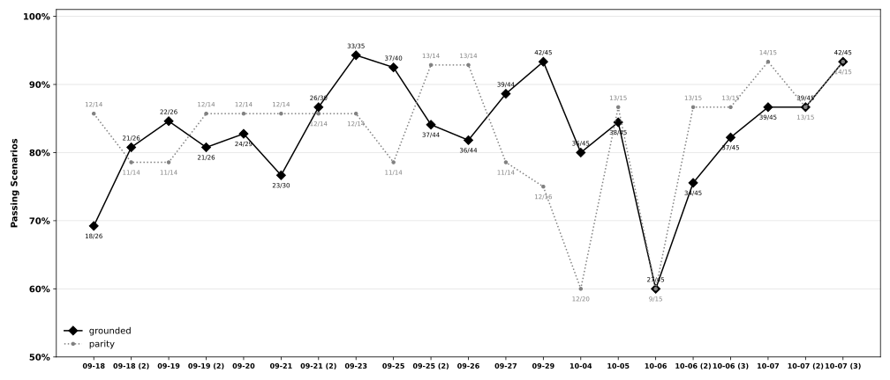
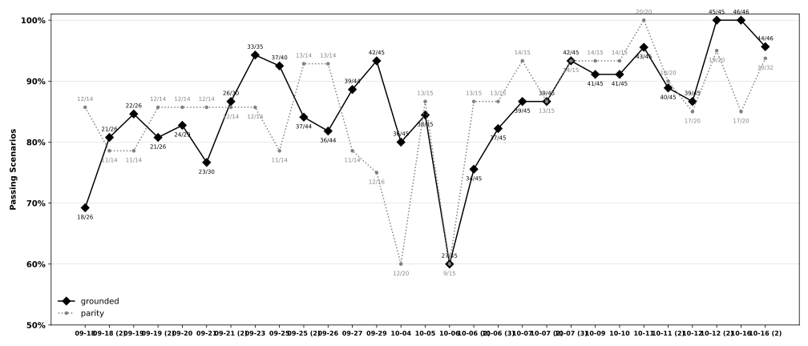

# agents

Evaluation and demonstration for Galaxy agents: what an agent actually accomplishes in a real
Galaxy, measured from outside it. Two outputs share one scenario corpus: baselines, and
recorded videos of watched runs. The agent under test lives in its own repository, named by
`OLIT_ROOT` and pinned to a commit when results are produced.



Each point is a baseline run of the full suite, labelled by date, with passing scenarios out of
the total beside it. A scenario passes when every run of it passes.



The baselines from 2026-09-18 to 2026-10-16, scored in separate tiers before the cleanup, are
kept as they were charted. Their snapshots are in [evals/snapshots/archive](evals/snapshots/archive).

```bash
export OLIT_ROOT=~/loom/browser
export GALAXY_URL=... GALAXY_API_KEY=...

python3 evals/run.py                 # behavioural scenarios against a real model and Galaxy
python3 evals/falsify.py             # break the agent on purpose; an eval that still passes is not measuring
```

## The boundary

The agent's own repository owns its implementation and the tests of it, including consistency
between the agents built on loom. This repo owns what judges an agent from outside: scenarios,
the harness, grading, baselines, falsification and watched runs. Scenarios come from here and
from loom's `evals/scenarios`, read as loom writes them (see [evals/README.md](evals/README.md)).

The harness reads an agent through what it publishes about itself, not its source:

```bash
cd $OLIT_ROOT && npm run build:session && node dist/session.mjs --describe --root .
```

`description.py` loads that description, and `subject.py` names the checkout and the session
the harness drives. Falsification is the exception: it edits the agent's source on purpose.

## Layout

```
description.py   an agent's published surface
subject.py       which checkout is under test, and how its code is reached
settings.py      the knobs: run budgets, Galaxy waits, watched runs and their videos
evals/           scenarios, harness, grading, falsification, fixtures, snapshots, watched runs
```
